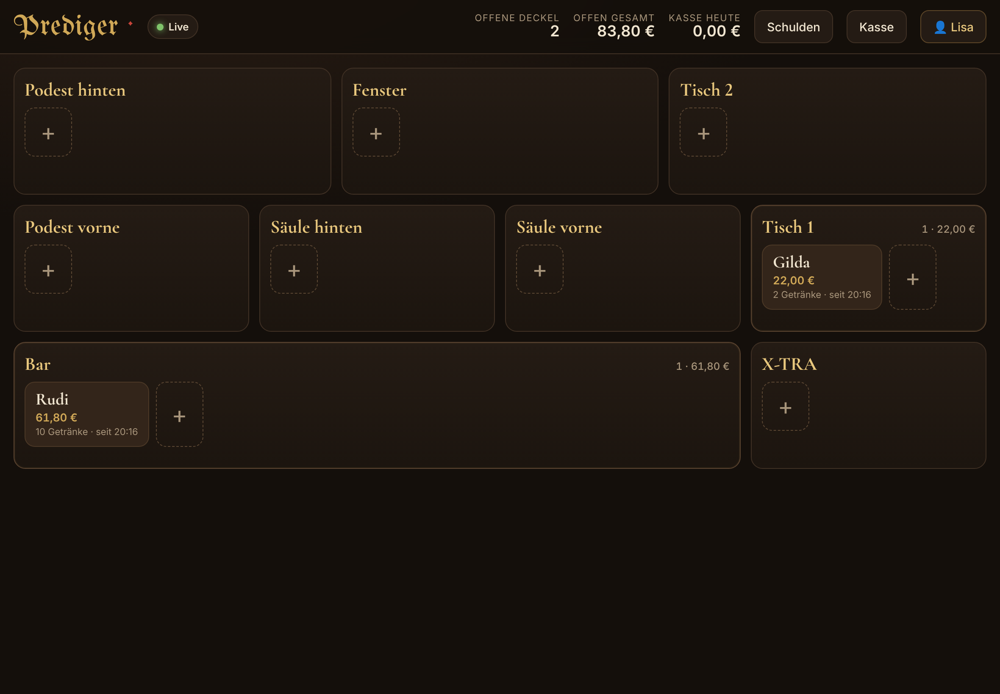

# Prediger Deckel – Einrichtung (ca. 10 Minuten)

Die App läuft kostenlos über **Google Sheets + Google Apps Script**.
Alle Daten (Deckel, Zahlungen, Schulden, Auslagen, Karte) liegen in **einer Google-Tabelle** in eurem Konto.
Es gibt **keine Anbindung** an Kartenterminal oder PayPal: Die App hält nur fest, wie bezahlt wurde (für den Kassenschnitt und zum Nachvollziehen).
Alle Mitarbeiter öffnen denselben Link auf Tablet oder Handy und melden sich mit einer PIN an. Ein eigenes Google-Konto braucht niemand.

---

## 1. Tabelle anlegen
1. Mit dem Google-Konto der Bar anmelden (am besten ein eigenes, z. B. `prediger.bar@gmail.com`).
2. <https://sheets.new> öffnen und die Tabelle **„Prediger Deckel“** nennen.

## 2. Code einfügen
1. In der Tabelle: **Erweiterungen → Apps Script**.
2. Links die Datei `Code.gs` anklicken, alles löschen und den Inhalt von [`apps-script/Code.gs`](apps-script/Code.gs) einfügen.
3. Links auf **＋ → HTML** klicken und die Datei genau **`index`** nennen (ohne .html). Den Inhalt löschen und [`apps-script/index.html`](apps-script/index.html) einfügen.
4. Speichern (💾 oder Strg+S).

## 3. Einmal einrichten
1. Oben in der Auswahlliste die Funktion **`einrichten`** wählen und auf **▷ Ausführen** klicken.
2. Google fragt nach Berechtigungen: **Berechtigungen prüfen** → Konto wählen → *„Google hat diese App nicht überprüft“* → **Erweitert** → **Zu Prediger Deckel wechseln (unsicher)** → **Zulassen**.
   *(Das ist normal: Es ist euer eigenes Skript und es greift nur auf diese Tabelle zu.)*
3. In der Tabelle gibt es jetzt die Blätter *Deckel, Zahlungen, Schulden, Auslagen, Karte, Statistik, Stammgäste, Einstellungen*.
4. **Im Blatt „Einstellungen“ die PIN ändern!** Standard ist `0000`.

## 4. Als Web-App freigeben
1. Im Apps-Script-Editor oben rechts **Bereitstellen → Neue Bereitstellung**.
2. Beim Zahnrad **Typ: Web-App** wählen.
3. **Ausführen als:** *Ich* · **Zugriff:** *Jeder*
4. **Bereitstellen** klicken und die **Web-App-URL** kopieren (endet auf `/exec`).

## 5. Auf Tablet und Handys
1. Die URL öffnen, die PIN und den eigenen Namen eingeben.
2. Als App-Symbol ablegen:
   - iPhone/iPad (Safari): Teilen → **Zum Home-Bildschirm**
   - Android (Chrome): ⋮ → **Zum Startbildschirm hinzufügen**
3. Den Link nur ans Team geben. Wer den Link und die PIN hat, kommt rein.

> Google blendet oben einen grauen Hinweis ein: „Diese Anwendung wurde von einem Google Apps Script-Nutzer erstellt“. Den kann man nicht abschalten, er stört aber nicht.

---

## Bedienung im Alltag

| Was | Wie |
|---|---|
| Neuer Gast | Beim Platz auf **＋** tippen, Namen eingeben (oder leer lassen → „Gast 1“). Pro Platz gehen beliebig viele Deckel, z. B. mehrere Runden an Tisch 1. |
| Getränk buchen | Antippen = ein Strich. Oben steht **„Nochmal dasselbe“**, darunter die **Meistverkauften** (lernt von selbst). Vertippt? → **Rückgängig** oder **−**. |
| Zigarre / Sonderpreis | **＋ Freier Artikel** → fest in die Karte aufnehmen (Kategorie „Zigarren“) oder nur einmalig. |
| Umsetzen | Gast wechselt den Platz oder wird mit einem anderen Deckel zusammengelegt. |
| Abrechnen | **Bar** (mit Rückgeld), **EC-Karte**, **PayPal** oder **Anschreiben**. Getrennt zahlen: Mengen mit − / + wählen, der Rest bleibt auf dem Deckel. |
| Schulden | Knopf **Schulden** oben: alle Offenen nach Namen. Antippen → zahlen (auch in Raten). **＋ Anschreiben** für Schulden ohne Deckel. |
| Auslage | **Kasse → ＋ Auslage**, z. B. Zitronen gekauft. Wird vom Bargeld abgezogen. |
| Kassensturz | **Kasse** zeigt Bar / EC / PayPal, Auslagen, **Soll in Kasse** und was angeschrieben wurde. Die Nacht zählt bis 8 Uhr morgens zum Vortag. |
| Karte & Preise | **Kasse → Karte bearbeiten**, oder direkt in der Tabelle im Blatt **„Karte“** (z. B. neue Zigarrenpreise). Eine neue Zeile mit Kategorie `Zigarren` reicht, die ID darf leer bleiben. |

**Kein Netz?** Oben steht dann *„Offline · 3 offen“*. Einfach weiterbuchen: Alles wird auf dem Gerät gemerkt und automatisch nachgeschickt.
Doppelt gebucht wird dabei nichts.

**Synchronisation:** Die Geräte gleichen sich alle ~4 Sekunden ab.

### Was man in der Tabelle *nicht* anfassen sollte
- Das Blatt **Deckel** wird ständig von der App überschrieben. Dort bitte nichts ändern.
- Spalten mit `_` am Anfang (z. B. `_items`) braucht die App intern.
- **Zahlungen** und **Auslagen** werden nur angehängt. Eine Fehlbuchung dort einfach von Hand löschen oder korrigieren.

---

## Updates einspielen
Neuen Code wie in Schritt 2 einfügen, dann **Bereitstellen → Bereitstellungen verwalten → ✏️ → Version: Neue Version → Bereitstellen**.
Die URL bleibt gleich.

## Ohne Google ausprobieren
[`bar-deckel/index.html`](bar-deckel/index.html) ist dieselbe App im **Demo-Modus**: einfach im Browser öffnen.
Die Daten bleiben dabei nur auf diesem einen Gerät.

## Für Entwickler
- `apps-script/Code.gs`: Server, Tabellen-Zugriff und die gemeinsame Logik (`applyOp`), die auch im Browser läuft
- `apps-script/index.html`: Oberfläche
- `node scripts/build-demo.js`: baut die Demo-Datei neu
- `node scripts/test-server.js`: testet den Server gegen eine nachgebaute Google-Tabelle
